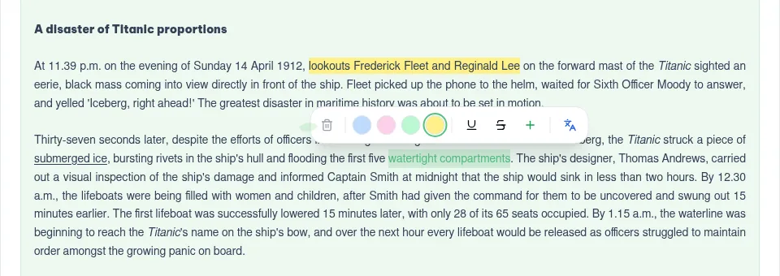
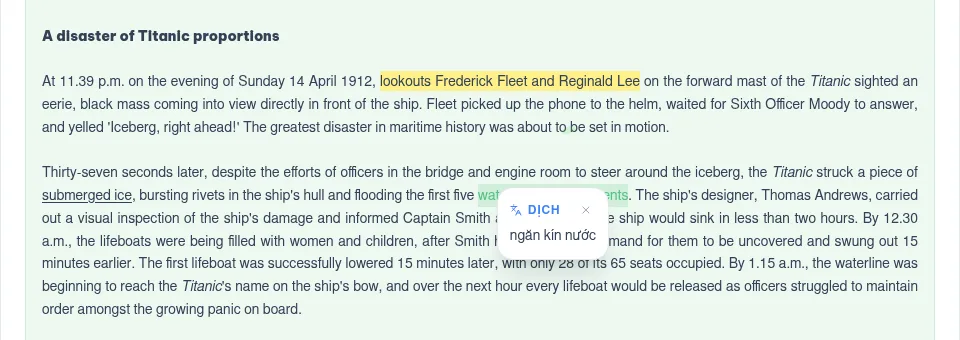
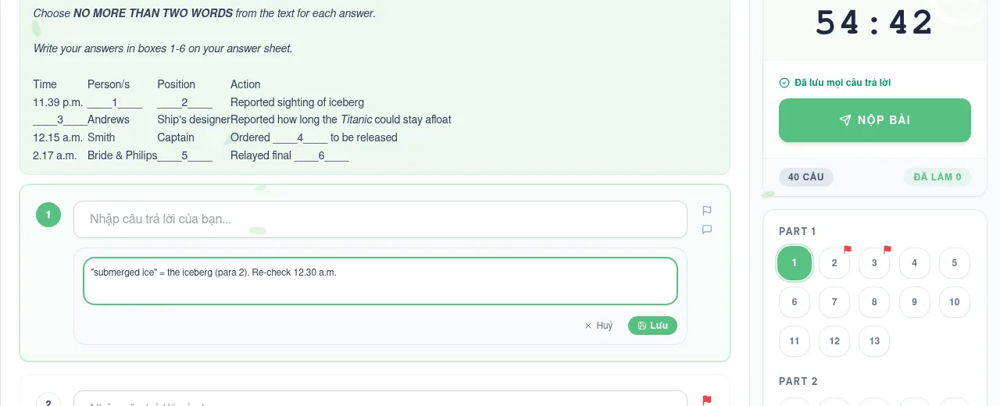
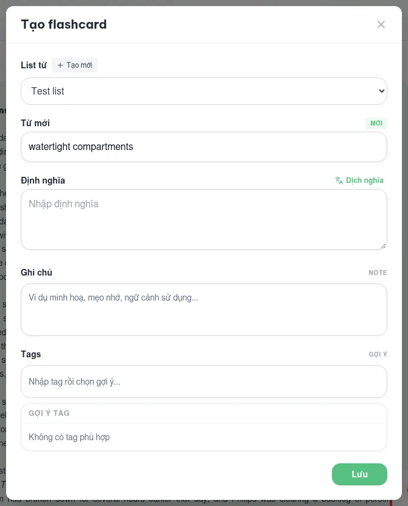
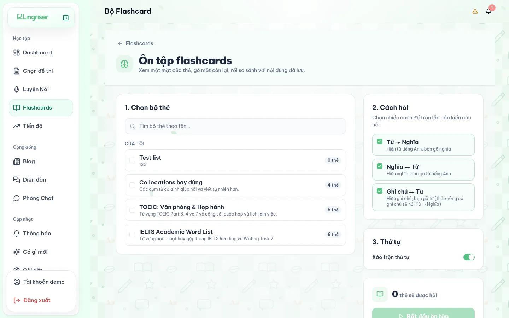
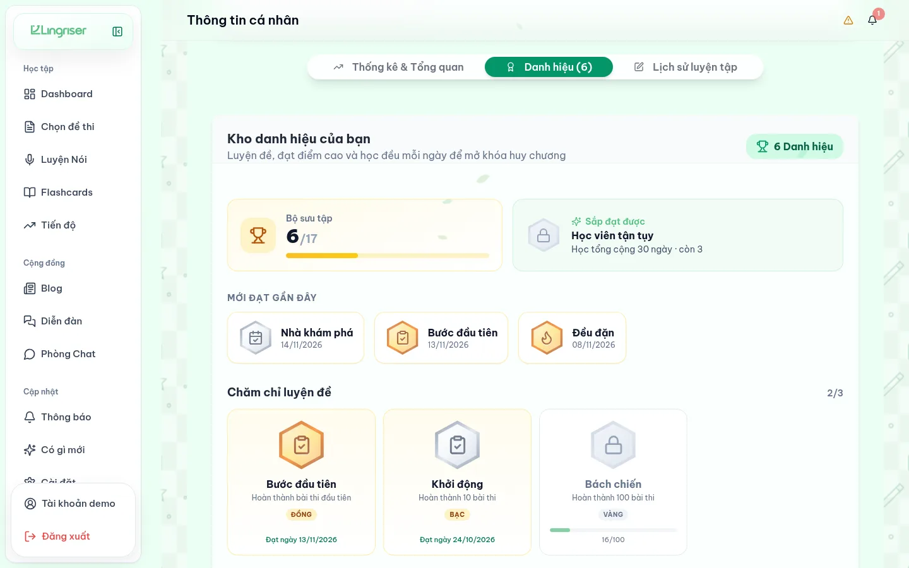
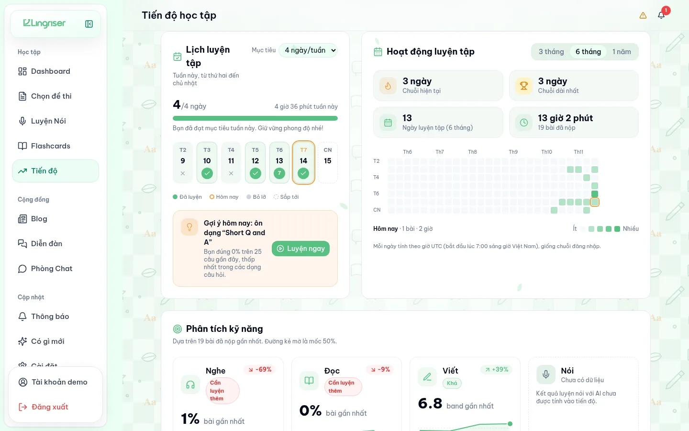
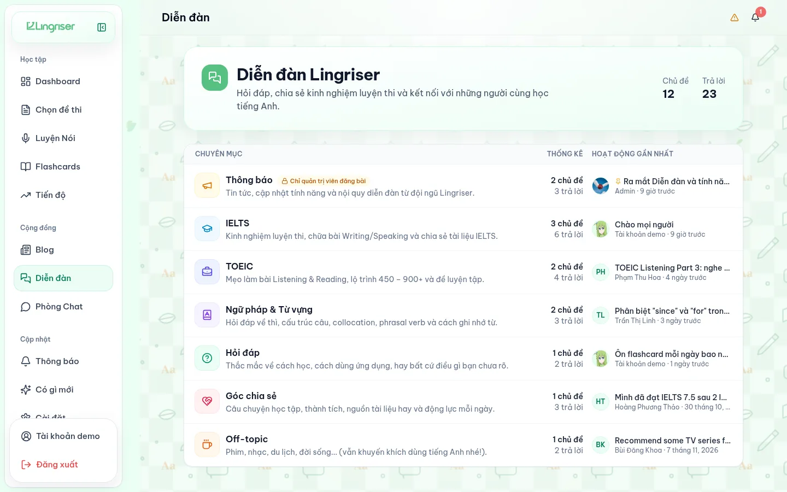
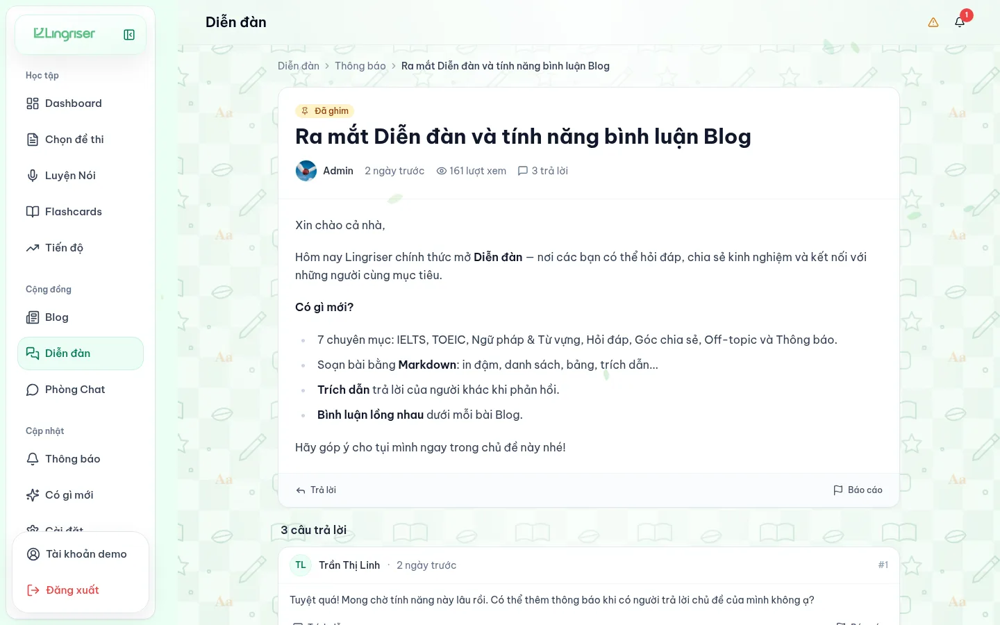

<div align="center">


### IELTS & TOEIC practice with AI scoring

The web frontend for [meowlish](https://github.com/HDkit/meowlish): real-format mock tests, Speaking & Writing practice with AI feedback, flashcards and progress tracking.

[](https://meowlish-fe.vercel.app)


[Live site](https://meowlish-fe.vercel.app) · [Backend](https://github.com/HDkit/meowlish) · [Changelog](https://meowlish-fe.vercel.app/changelog)

</div>

## Try it

Open **[meowlish-fe.vercel.app](https://meowlish-fe.vercel.app)** and press **"Dùng thử bằng tài khoản demo"** on the login page, or sign in by hand:

| Email | Password |
|---|---|
| `demo@lingriser.test` | `Demo@12345` |

The demo account is shared, so its password, username and sign-in methods can't be changed (the backend refuses with `403`). Anyone can edit its other data, and a backend reseed resets it.

> [!NOTE]
> AI services are paused for now: Speaking scoring and AI answer explanations are off, and Writing returns random sample scores. Everything else works, including translation in tests and flashcards. Set `NEXT_PUBLIC_AI_SERVICE_OPERATIONAL=true` at build time to remove the notice.

## Features

| | |
|---|---|
| **Mock tests** | IELTS Academic and TOEIC Listening & Reading in the real exam format, with real audio and images |
| **Study tools in the test** | Highlight, underline, strike through, translate a selection, turn it into a flashcard, flag questions and write notes, all without leaving the exam |
| **Speaking & Writing** | Practice with AI scoring and feedback on pronunciation, grammar and vocabulary |
| **Flashcards** | Personal and public decks, a review mode, copies of other people's decks and change proposals |
| **Gamification** | 17 badges in bronze, silver and gold, learning streaks, a weekly practice goal and an activity heatmap |
| **Progress** | Score trends, per-skill strengths and weaknesses, and a suggestion of what to practise next |
| **Community** | Forum, blog with nested comments, and chat rooms (socket.io) |
| **Staff tools** | Exam creation, review and approval; forum moderation; blog, user and report management |

Screenshots below are from the demo account. The interface is in Vietnamese.

### Study tools while taking a test

Select any text in a reading passage or question and a toolbar appears above it. Nothing in it stops the timer or leaves the page.

<p align="center">
  
</p>

- **Highlight** in yellow, green, pink or blue, **underline** or **strike through** a phrase. Click a mark to change its colour or remove it.
- **Translate** the selection into Vietnamese in place, so an unknown word doesn't cost you the passage.
- **Create a flashcard** from the selection. The word is filled in, *Dịch nghĩa* adds its translation as the definition, and you pick the deck (or create one) and tags right there.
- **Flag** a question to come back to it. Flags show as red markers on the question palette.
- **Notes** per question, saved with the attempt.
- **Autosave**: every answer is saved as you go ("Đang lưu… / Đã lưu"), the test is only submitted once every answer is saved, and the page warns before you leave with unsaved answers.

<table>
  <tr>
    <td width="50%"></td>
    <td width="50%"></td>
  </tr>
  <tr>
    <td align="center"><sub>Translate a selection</sub></td>
    <td align="center"><sub>Notes and flags</sub></td>
  </tr>
</table>

<p align="center">
  
  <br /><sub>Turn a selection into a flashcard without leaving the test</sub>
</p>

### Flashcards

Decks can be private or public. The **Khám phá** (Discover) tab lists public decks by name or tag; you can save a copy of someone else's deck, keep it in sync with the original, and send the owner a **change proposal** that they review card by card (added, edited, removed) before accepting or rejecting it.

**Review mode** (`/flashcards/review`) asks across any of your decks in three directions (word → meaning, meaning → word, note → word). You type what you remember and compare it with the saved card. There is no score, so it's safe to just practise.

<p align="center">
  
</p>

### Gamification

- **Badges**: 17 medals in five families (tests completed, good scores, perfect scores, days studied, day streaks), each in bronze, silver and gold. The profile's *Danh hiệu* tab shows the collection, the next badge within reach and progress towards every locked one.
- **Streaks**: current and longest run of practice days.
- **Weekly goal**: pick how many days a week you want to practise; the week view ticks off each day and says when the goal is met.
- **Activity heatmap** over 3, 6 or 12 months, plus a daily suggestion of which question type to practise next.

<table>
  <tr>
    <td width="50%"></td>
    <td width="50%"></td>
  </tr>
  <tr>
    <td align="center"><sub>Badge collection</sub></td>
    <td align="center"><sub>Weekly goal, streaks and heatmap</sub></td>
  </tr>
</table>

### Forum

Seven categories (announcements, IELTS, TOEIC, grammar & vocabulary, Q&A, sharing, off-topic). Threads and replies are written in Markdown, and you can quote another reply when answering. Thread authors get a notification on new replies. Moderators can pin, lock or delete threads, and anyone can report a thread or reply.

<table>
  <tr>
    <td width="50%"></td>
    <td width="50%"></td>
  </tr>
</table>

## Getting started

Requires Node.js 24 and a running [meowlish](https://github.com/HDkit/meowlish) gateway (local or remote).

```bash
npm ci
cp .env.local.example .env.local   # then set NEXT_PUBLIC_API_URL
npm run dev                        # http://localhost:6767
```

To work against the hosted backend instead of a local one, set `NEXT_PUBLIC_API_URL=https://meowlish.servebeer.com`.

### Scripts

| Command | What it does |
|---|---|
| `npm run dev` | Dev server on port 6767 |
| `npm run build` / `npm start` | Production build and server |
| `npm test` | Unit tests (Vitest) |
| `npm run share` | Deploys your working copy, uncommitted changes included, to [meowlish-fe-share.vercel.app](https://meowlish-fe-share.vercel.app) |

### Environment

| Variable | Purpose |
|---|---|
| `NEXT_PUBLIC_API_URL` | Gateway origin that `/api` and `/socket.io` are proxied to. Read at build time. |
| `NEXT_PUBLIC_AI_SERVICE_OPERATIONAL` | `true` hides the "AI services paused" notice |
| `NEXT_PUBLIC_DEMO_ACCOUNT` | `false` hides the demo-account button |
| `NEXT_PUBLIC_DEMO_EMAIL` / `NEXT_PUBLIC_DEMO_PASSWORD` | Override the demo credentials |

See `.env.local.example` for the full list.

## Deployment

| Trigger | Target | URL |
|---|---|---|
| Push to `main` | Vercel project `meowlish-fe` (production) | [meowlish-fe.vercel.app](https://meowlish-fe.vercel.app) |
| `npm run share` | Vercel project `meowlish-fe-share` | [meowlish-fe-share.vercel.app](https://meowlish-fe-share.vercel.app) |

**CI/CD** (`.github/workflows/deploy.yml`): every push to `main` runs the tests, builds with `vercel build --prod` and ships the result with `vercel deploy --prebuilt --prod`. It needs the repo secrets `VERCEL_TOKEN`, `VERCEL_ORG_ID` and `VERCEL_PROJECT_ID`. `NEXT_PUBLIC_API_URL` comes from the Vercel project's Production environment. You can also start it by hand from the Actions tab.

**`npm run share`** needs `npx vercel login` once, or a `VERCEL_TOKEN` in `.env.vercel` (see `.env.vercel.example`). It deploys to a separate project, so it never replaces the main site, and it prints only the stable URL. Each deploy also gets its own long URL, but that one sits behind Vercel login and the gateway refuses logins from it.

> [!IMPORTANT]
> The gateway only accepts logins from origins listed in its `CORS_ORIGINS`. A new frontend domain has to be added there (in the backend's `docker/.env.services`) before login works on it.

## Backend (API) connection

The browser never calls the backend host directly. Every API call goes to this app's own
origin (`/api/v1/...`, `/socket.io/...`) and `next.config.ts` rewrites it to the backend
gateway. That keeps the gateway's `SameSite=Lax` HttpOnly session cookies first-party: a
frontend on one host and the API on another (e.g. two `*.servebeer.com` / `*.ddns.net`
hosts, which are public suffixes and so different sites) would never store or send them.

- `NEXT_PUBLIC_API_URL`: the gateway origin the rewrites forward to (default
  `https://meowlish.servebeer.com`, locally `http://localhost:3000`; a trailing `/api` is
  ignored). Rewrites are baked in at build time, so set it before `npm run build`.
- `/api/:path*` -> `<NEXT_PUBLIC_API_URL>/api/:path*`. This includes the Google OAuth
  callback `/api/v1/auth/google/callback`, so no page may be added under `src/app/api/v1/auth/google/`.
  The gateway's `BASE_URL` must be this frontend's public origin, and its `CORS_ORIGINS` must
  list it (the browser still sends `Origin: <frontend>`, which the gateway checks).
- `/socket.io/:path*` -> `<NEXT_PUBLIC_API_URL>/api/v1/chat/ws/socket.io/:path*` (chat).
  The client starts with long-polling, which works through any HTTP proxy, and upgrades to
  WebSocket only when the proxy forwards upgrades. In production put a reverse proxy
  (nginx/Envoy) in front that routes `/api` and `/socket.io` (with WebSocket upgrades) straight
  to the gateway and sets `X-Forwarded-For`; Next's built-in proxy doesn't add it.

## Project structure

```
src/
├── app/            Next.js App Router: (app)/ signed-in pages, auth/, landing/, changelog/
├── components/     Page components and shared UI (ui/ is shadcn/ui on Radix)
├── lib/            API client, auth session, Redux store, hooks, small tested helpers
├── services/       Browser-side speech, audio and AI service wrappers
└── middleware.ts   Redirects signed-out visitors away from protected routes
public/             Logos, fonts and landing photos
docs/screenshots/   README screenshots
scripts/            Vercel deploy helpers behind `npm run share`
```

For the Speaking module (speech recognition, Whisper, Gemini) see [SPEAKING_SETUP.md](SPEAKING_SETUP.md).

## Credits

Started from a [Figma Make](https://www.figma.com/design/PHZXpxzL3v5LSpH4IRCSvB/AI-English-Exam-Prep-System) export. UI components are from [shadcn/ui](https://ui.shadcn.com/) (MIT), and photos are from [Unsplash](https://unsplash.com) under the [Unsplash license](https://unsplash.com/license). See [src/Attributions.md](src/Attributions.md).
